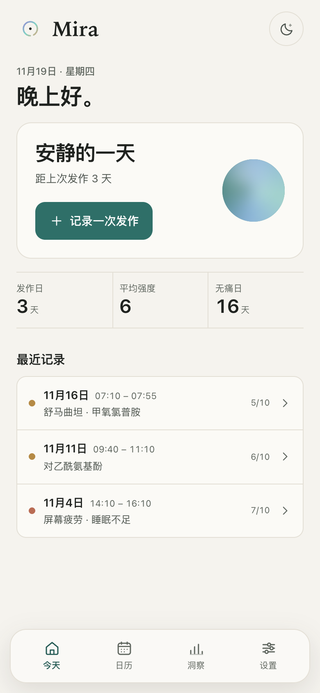
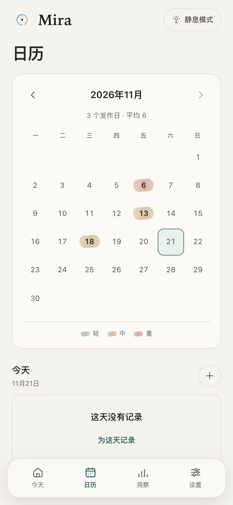
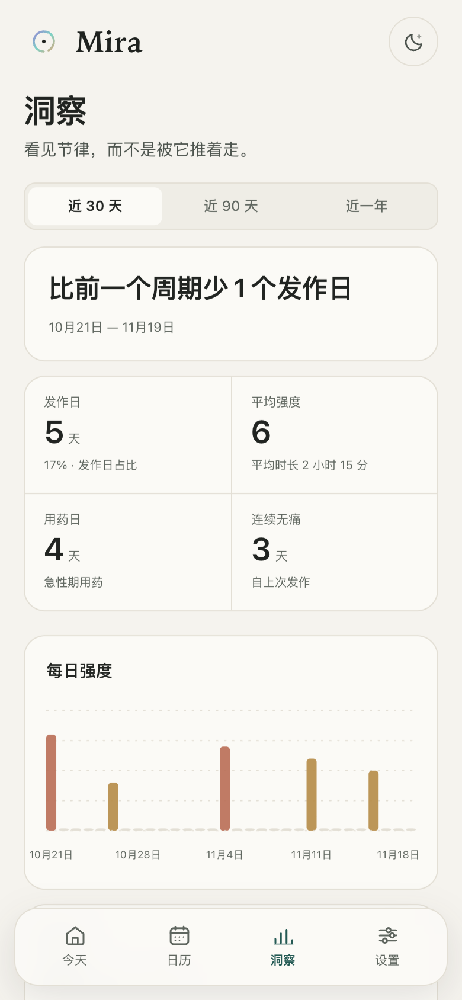
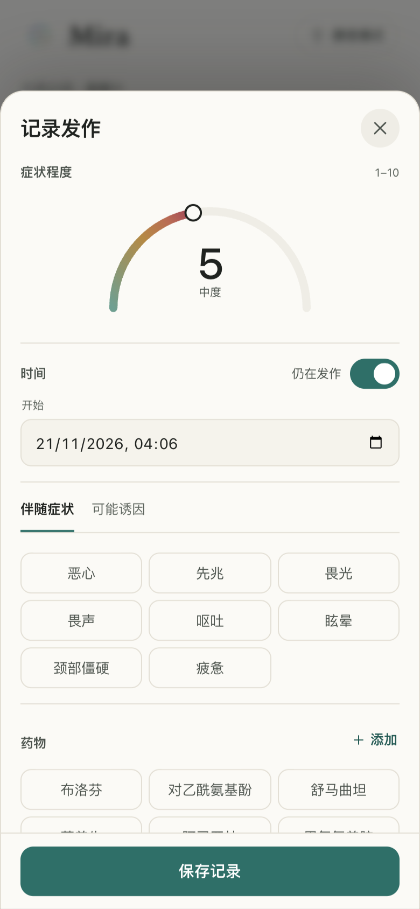
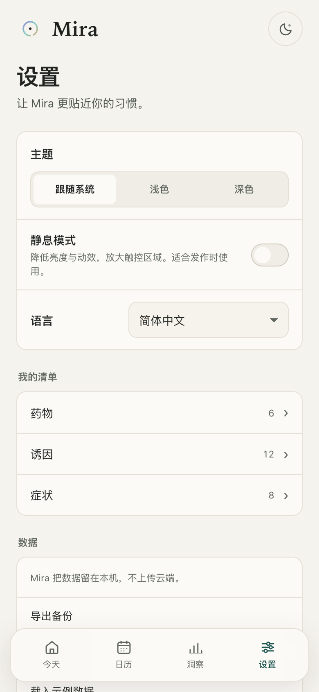
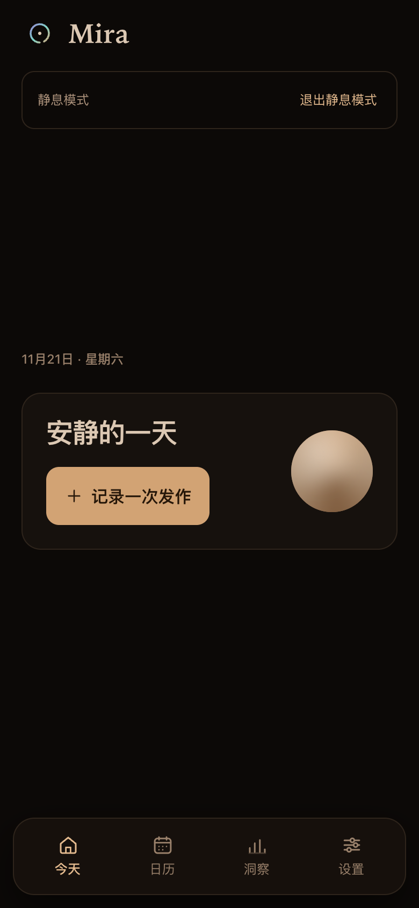
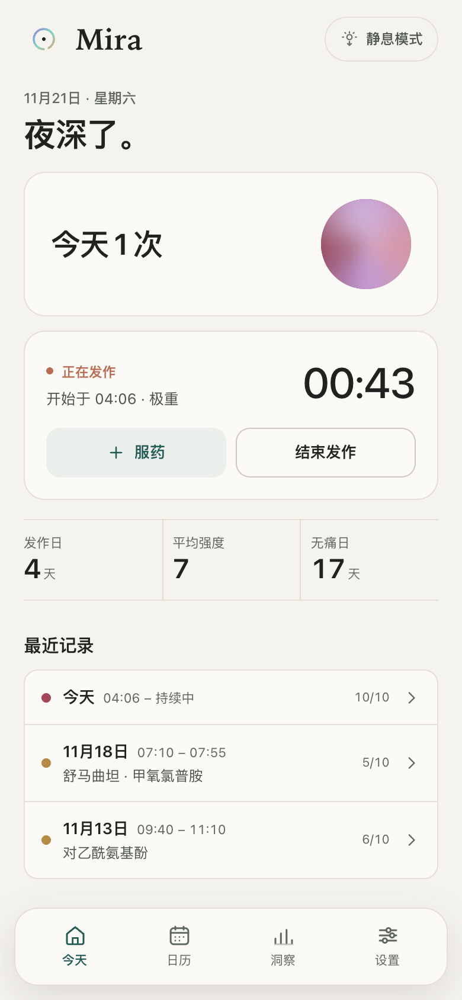
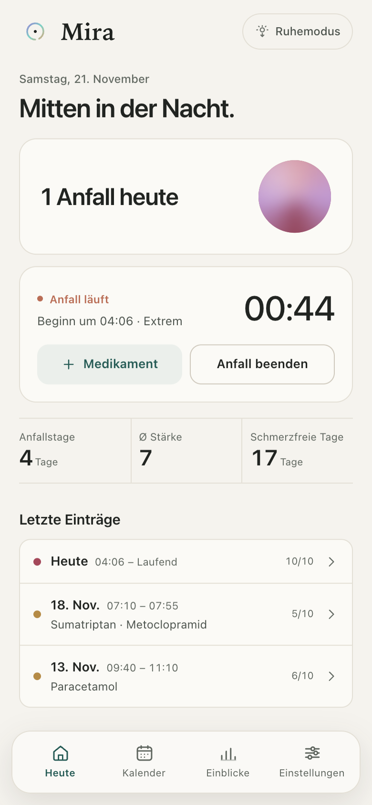
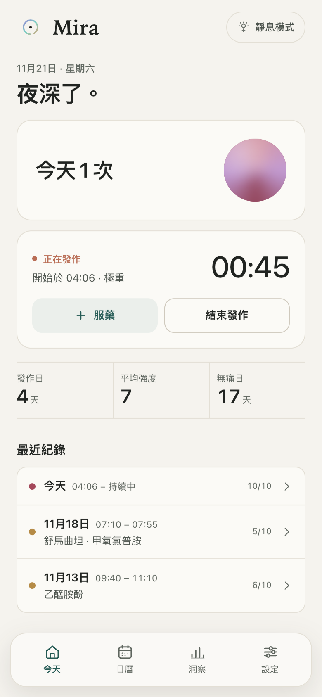

# Mira

**一盏安静的灯，照看你的偏头痛节律。**

Mira 是一个本地优先的偏头痛日历与用药记录应用。它把「记录」做得足够轻，把「洞察」做得足够克制：不评判、不催促、不上传。可安装为 PWA，也预留了 Capacitor 原生壳。

**在线评测：** https://lulgabc.github.io/Mira/

构建使用相对资源路径，同一份产物可部署到 GitHub Pages 子路径、自定义域名或 Capacitor 本地 WebView。推送 `main` 后由 `.github/workflows/deploy.yml` 自动构建并发布。

<p align="center">
  
  
  
</p>

<p align="center">
  
  
  
</p>

<p align="center">
  
  
  
</p>

---

## 为什么是 Mira

偏头痛不是一条待办事项。发作时，屏幕的光、滑动的动效、复杂的分支表单都会让记录变得更难。

Mira 因此做了三件事：

- **降低记录成本**：首页只有一个主按钮，记录页只保留必需字段；强度用圆环拖动，药物与症状一点即选。
- **照顾发作中的身体**：静息模式降低亮度与彩度、关闭动效、放大触控区域；深色模式与系统主题同步。
- **把数据还给你**：没有账户、没有云同步、没有广告。所有记录只保存在本机，可随时导出为 JSON。

## 功能

### 今天

- 今日头部状态、距上次发作天数、本月发作日 / 平均强度 / 无痛日。
- **正在发作**：实时计时、快速补记药物、一键结束；进行中时主按钮自动隐藏。
- 最近记录：强度小圆点、日期时间、药物或诱因、强度分级。

### 记录一次发作

- 开始 / 结束时间，支持「仍在发作」。
- **Aura Dial 半圆仪表**：1–10 级，拖动或键盘方向键调整；中心显示「极轻 → 极重」的文字描述，纵向占用更紧凑。
- 伴随症状与可能诱因（选填）合并为同一组标签页，按需切换，不再纵向堆叠两组选项。
- 常用药物以标签多选；选中后只在下方展开剂量与缓解程度（无效 / 部分 / 明显），并可在记录中临时添加一种常用药。
- 备注、编辑与两步删除确认；整个记录表单比之前短约三分之一。
- 防止未来时间；一次只保留一个进行中的发作。

### 日历

- 月视图，用彩笔高亮条标注发作日（按当日最高强度着色）；今天、选中日、发作日都有独立状态。
- 点击日期查看当天记录，直接补记或编辑。
- 不能翻到未来月份，不能为未来日期补记。
- 月度摘要：发作日数与平均强度。

### 洞察

- 周期切换：近 30 天 / 90 天 / 一年。
- 自动生成的本地语言小结：与前一个周期相比多/少几个发作日；没有足够数据时给出诚实的说明。
- 指标合并为一个 2×2 面板：发作日、平均强度、平均时长、用药日、连续无痛、发作日占比。
- **每日强度图**（30 天）与发作趋势（90 天 / 一年），纯 SVG 绘制。
- 诱因、症状、用药合并为同一个「模式」卡片的三个标签页，减少纵向卡片堆叠。
- 所有统计只描述记录，不做因果推断，并附医疗免责声明。

### 我的清单

- 药物、诱因、症状三份清单都可编辑：新增、重命名、删除。
- 内置条目会跟随语言切换显示对应译名；删除采用归档方式，历史记录不会丢失。
- 数据：导出备份、导入备份、载入示例数据、清空全部数据。

### 多语言

- 简体中文、繁體中文、English、日本語、Français、Español、Deutsch、Italiano、Português。
- 首次启动按浏览器语言自动选择（含繁中 / 港台地区识别），也可在欢迎页或设置中即时切换。
- 日期、星期与月份通过 `Intl.DateTimeFormat` 本地化；药物、诱因、症状的内置名称也随之切换。
- 单元测试会检查九种语言的 key 完整性、占位符一致性，以及所有内置清单译名。

### 静息模式

- 首页顶部有带文字的「静息模式」快捷按钮，设置中也有开关；开启后为暖黑低光配色、关闭环境动效、放大按钮与触控区域。
- 静息模式会自动收起问候、月度统计、最近记录、页面副标题与说明性小字，只保留状态、主操作、进行中控制、导航和必要的安全说明。
- 适合发作中快速记录；再点一次即可退出。
- 与主题偏好独立，选择不会被覆盖。

### PWA 与跨平台

- Web App Manifest、192/512/maskable 图标、Apple touch icon。
- 自定义 Service Worker：应用外壳预缓存，静态资源运行时缓存，断网可重新打开。
- 响应式布局：手机优先，桌面保持 520px 阅读宽度；支持安全区域（刘海 / 底部手势条）。
- Capacitor 8 已配置，可在需要时生成 iOS / Android 原生工程。

## 设计语言

Mira 的视觉隐喻是「极光下的一只眼睛」：品牌符号是一个留出呼吸缺口的环，中心是一点暖色。它既像瞳孔，也像一天中慢慢移动的光。

- **色彩**：暖纸色 / 深墨色为底，只有一个深青强调色；强度用鼠尾草绿 → 琥珀 → 珊瑚 → 玫瑰的连续谱表达，且只出现在数据元素上。
- **字体**：界面、数字与洞察句统一使用系统无衬线；只有品牌字标「Mira」保留衬线，减少字体层次。
- **标志性交互**：Aura Dial 强度盘、缓慢旋转极光渐变的 76px 状态光球、进行中计时、静息模式。
- **收敛**：没有背景渐变、颗粒、装饰性图标、全大写小标题或重复的卡片；统计从 4 张卡 + 3 张卡收敛为 1 个指标面板 + 1 个标签页面板。
- **克制**：没有社交、排行榜、连续打卡惩罚、推送催促或广告。连续无痛天数只是安静地显示，不制造压力。

更完整的设计说明见 [docs/design.md](docs/design.md)。

## 技术栈

- **Preact 11 + Vite 8 + TypeScript 7**
- 无 UI 组件库、无图表库、无状态管理库、无 i18n 库
- 原生 `<dialog>` 作为模态层，浏览器负责焦点约束、Esc、返回手势
- 纯 SVG 图表；CSS 自定义属性驱动主题、强度色与静息模式
- `localStorage` 本地持久化（`mira.data.v1` / `mira.settings.v1`），JSON 备份导入 / 导出
- 生产包约 **166 kB JS / 35.5 kB CSS**（gzip 后约 **48 kB / 7.8 kB**）

### 数据模型

```ts
Episode {
  id, start, end?, severity (1–10),
  symptomIds[], triggerIds[], meds[],
  notes?, createdAt, updatedAt
}

EpisodeMed { medId, name, dose?, relief?: 0 | 1 | 2 }
CatalogItem { id, key?, label?, archived? }
```

药物名称在记录时保存快照；显示时优先按 `medId` 从当前清单解析，因此切换语言后历史记录仍显示当前语言的药名，而删除清单项也不会破坏历史。

## 本地运行

```bash
pnpm install
pnpm dev          # http://localhost:5173
```

其他命令：

```bash
pnpm build        # 类型检查 + 生产构建
pnpm preview      # 预览 dist（默认 4173）
pnpm test         # Vitest 单元测试
pnpm icons        # 重新生成 PNG/SVG 图标
```

### 验证

```bash
# 需要本地 dev server 运行在 5173
pnpm test:e2e

# 需要 preview 运行在 4173（或指定 BASE_URL）
pnpm preview &
pnpm test:offline

# 无障碍与响应式检查（需要 dev server）
pnpm test:a11y
pnpm test:responsive

# 线上部署检查（GitHub Pages）
pnpm test:live

# 重新生成文档截图（需要 Google Chrome）
pnpm dev &
pnpm screenshots
```

当前验证结果：

- `pnpm test`：**4 个测试文件，24 个测试全部通过**。
- `pnpm build`：TypeScript 无错误，构建成功。
- `node scripts/e2e.mjs`：**19 项端到端检查通过**，无控制台错误。覆盖欢迎页、示例数据、动态光球、Aura Dial、药物勾选不跳动/可正常滚动、剂量与缓解、进行中计时、快速服药、结束发作、日历编辑、两步删除、洞察图表、欢迎页与设置中的多语切换、主题与静息模式、导出、导入、清单增删改、清空数据、未来时间拦截、刷新持久化、清单与图标、PWA 快捷入口。
- `node scripts/offline-check.mjs`：Service Worker 接管页面后断网重载成功，示例数据仍在。
- `node scripts/a11y-check.mjs`：用 axe-core 检查 12 个页面/状态（欢迎页、今日、日历、洞察、设置、记录弹层，以及深色与静息模式），**WCAG 2 A/AA 违规为 0**。
- `node scripts/responsive-check.mjs`：在 320 / 375 / 430 / 768 / 1280 px 宽度下检查四个主页面与记录弹层，均无横向溢出。
- `pnpm test:live`：对线上 GitHub Pages 地址验证页面、Manifest、全部图标、Service Worker 作用域 `/Mira/` 与断网重载，全部通过。
- 截图与 E2E 脚本使用本机 Google Chrome（`playwright-core` 的 `channel: 'chrome'`）。

## 移动端安装与原生打包

### 部署到 GitHub Pages

仓库已包含 `.github/workflows/deploy.yml`：推送到 `main` 后，GitHub Actions 会安装依赖、运行单元测试、构建，并发布 `dist` 到 Pages。

- 生产构建使用相对资源路径（`base: './'`），因此 `/Mira/` 子路径、自定义域名和 Capacitor WebView 共用同一份产物。
- Service Worker 作用域随部署路径变化；在 Pages 上为 `/Mira/`，离线缓存与安装均正常。
- 线上地址：<https://lulgabc.github.io/Mira/>

### 作为 PWA 安装

- Android / Chrome：地址栏菜单 →「安装应用」；页面设置中也会出现安装入口（支持 `beforeinstallprompt` 时）。
- iOS / Safari：分享菜单 →「添加到主屏幕」。
- 需要 HTTPS 或 localhost；离线支持在第二次访问后生效。

### Capacitor（可选）

仓库已包含 `capacitor.config.ts`（App ID `app.mira.diary`）与 Capacitor 8 依赖。平台工程按需生成、不纳入版本库：

```bash
pnpm cap:add:ios       # 需要 Xcode
pnpm cap:add:android   # 需要 Android Studio / SDK
pnpm cap:sync          # 构建 web 资源并同步
pnpm cap:ios           # 打开 Xcode
pnpm cap:android       # 打开 Android Studio
```

原生壳内会跳过 Service Worker 注册；PWA 的离线逻辑不影响原生构建。正式发布前还需要补充原生图标与启动图。

## 项目结构

```text
src/
  app.tsx                 应用状态、主题、路由与各弹层编排
  views/
    TodayView.tsx         今日状态、进行中发作、快速记录
    CalendarView.tsx      月历与单日记录
    InsightsView.tsx      统计看板
    SettingsView.tsx      外观、清单、数据、关于
  components/
    EpisodeSheet.tsx      记录 / 编辑表单
    SeverityDial.tsx      Aura Dial 强度盘
    CatalogSheet.tsx      药物 / 诱因 / 症状管理
    QuickMedSheet.tsx     发作中快速服药
    Charts.tsx            纯 SVG 趋势图
    Sheet.tsx             native <dialog> 封装
  lib/
    dates.ts             本地日期、时长、Intl 格式化
    stats.ts             统计、分桶、排行、连续无痛
    storage.ts           校验、持久化、备份导入导出
    sample.ts            示例数据
    catalog.ts           内置清单
    types.ts             数据模型
  i18n/                   zh / en / ja 字典与解析
tests/                    Vitest 单元测试
scripts/                  图标、截图、E2E、离线验证
docs/screenshots/         应用截图
```

## 多语言贡献

1. 复制 `src/i18n/en.ts` 为新语言文件，补全相同的 key。
2. 在 `src/i18n/index.ts` 的 `dictionaries` 与 `LANGS` 中注册，并补上 `localeOf` 映射。
3. 在 `src/lib/types.ts` 的 `Lang` 中加入语言代码；在 `src/lib/dates.ts` 补充 `LOCALES`、`UNITS` 与日期分支；在 `CalendarView` 补充星期缩写。
4. 在 `index.html` 的早期脚本中补充语言 → locale 映射。
5. 运行 `pnpm test`：九语 key 完整性、占位符一致性、内置清单译名与日期格式测试必须通过。

## 隐私与安全

- 无账户、无后端、无分析脚本、无第三方字体或 CDN 请求。
- 数据仅存于浏览器 `localStorage`，清理站点数据会删除记录；建议定期导出备份。
- 导入文件会经过结构校验与数值裁剪，未知字段被丢弃，笔记按纯文本渲染。
- 本项目用于自我观察，**不是医疗器械，不能替代医生的诊断与治疗**。若出现突发剧烈头痛、发热、意识改变或神经功能缺损，请及时就医。

## 已知边界

- 单设备本地存储，无跨设备同步；这是刻意的隐私取舍，可通过 JSON 备份迁移。
- 没有推送提醒与服药提醒，避免把头痛变成另一套待办系统。
- 当前提供九种语言：简中、繁中、英、日、法、西、德、意、葡；新增语言按上文步骤扩展。
- 原生平台仅完成配置与同步路径，尚未附带签名、商店元数据与原生启动图。
