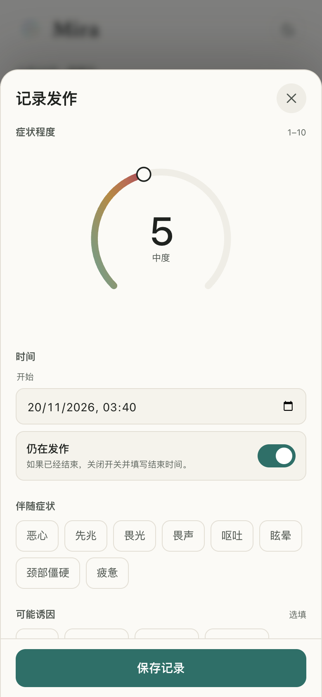
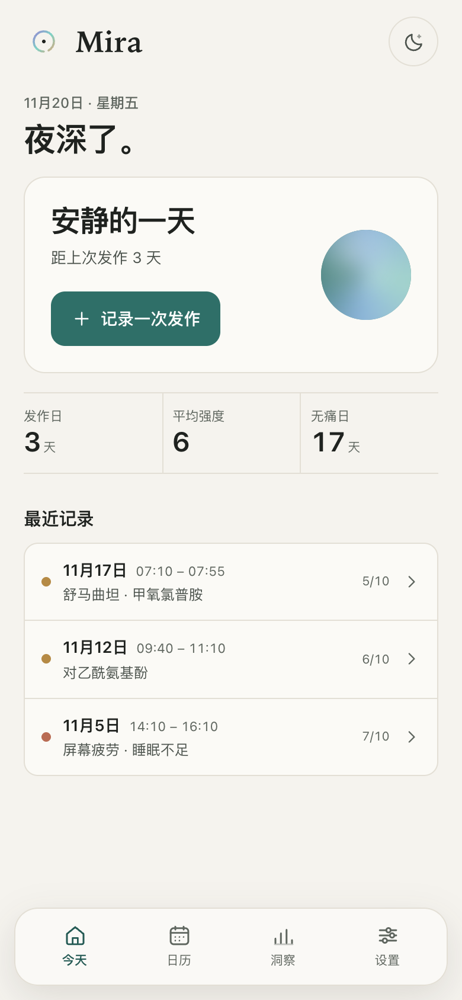
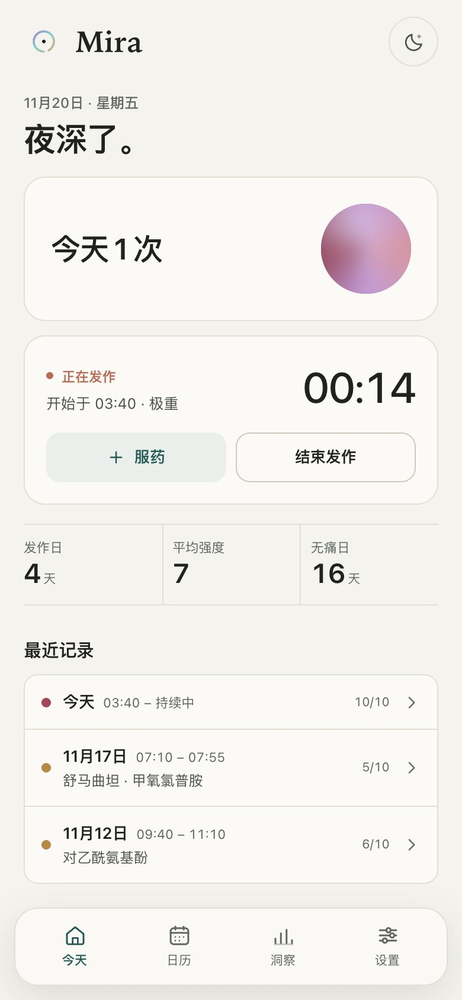
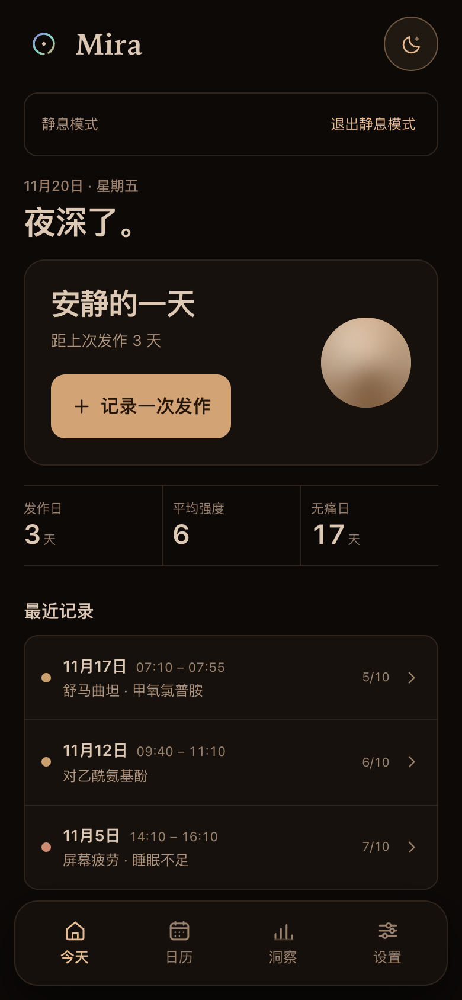

# Mira 设计说明

> 目标：做一个不喧哗、但足够有辨识度的偏头痛记录工具。  
> 关键词：留白、低刺激、单一强调色、可退让。

## 1. 命名与意象

Mira 来自「注视」的意象：看清自己的节律，而不是被头痛推着走。

品牌符号是一个留出缺口的环，像极光中的一只眼睛。它只出现在应用图标、页头和欢迎页，不再参与页面内的装饰。

## 2. 视觉系统

### 一个强调色，三种强度语义

| 角色 | 浅色 | 深色 | 用途 |
| --- | --- | --- | --- |
| 背景 | 暖纸 `#f5f3ee` | 墨黑 `#0f1112` | 页面底色，无环境渐变、无颗粒 |
| 表面 | `#fbfaf6` | `#171a1b` | 卡片，仅靠 1px 边框分层 |
| 主色 | 深青 `#2f6f68` | 浅青 `#8ad3c7` | 主按钮、链接、当前标签 |
| 强度 | 鼠尾草 → 琥珀 → 珊瑚 → 玫瑰 | 同色相提亮 | **只用于数据**：光球、强度盘、日历彩笔高亮、图表 |

界面不再使用紫色/橙色的装饰渐变。极光只保留在品牌图标里；页面背景是一张干净的纸。

### 字体

- 全部界面文案、数字、图表标签使用系统无衬线字体。
- 只有品牌字标「Mira」保留衬线字体，作为唯一的编辑感来源。
- 数字统一使用 `font-variant-numeric: tabular-nums`，让计时器与统计保持稳定。

### 形状与层级

- 卡片圆角 16–18px，按钮/输入 10–12px，导航 20px。
- 无卡片阴影；只有底部导航与弹层有阴影，用来区分层级。
- 页面宽度 520px，单列阅读；间距以 4/8px 为基准。
- 没有多余的 eyebrow、图标徽章、彩色标签或全大写小标题。

## 3. 标志性交互

### Aura Dial 强度盘

- 270° 开放圆环，中心只显示数字与「极轻 → 极重」的文字。
- 去掉了刻度点和装饰性提示，保留拖动、键盘方向键、Home/End。
- 环的颜色从鼠尾草绿过渡到玫瑰色；这是页面上最饱和的颜色，因为它与数据直接相关。

### 今日状态光球

- 76px，内部极光渐变以 16s 缓慢旋转，叠加 9s 漂移高光，形成持续但不刺眼的色彩流动。
- 去掉外环、缩放呼吸与光晕；`prefers-reduced-motion` 和静息模式下完全停止。
- 它是当日最高强度的单色映射：安静时青绿，强度升高时转向琥珀、珊瑚、玫瑰。
- 不是数据主角，只是一眼可读的状态点；具体数字仍在标题与统计中。

### 正在发作

- 计时器、开始时间、服药与结束，构成唯一的行动区。
- 进入进行中状态后，首页主按钮自动隐藏，避免重复记录；行动集中在这张卡片。
- 最近记录只写「18:08 – 持续中」与强度，不再重复第二行「持续中」。

### 静息模式

- 暖黑底色、关闭动效、放大触控目标；不改变用户的浅色/深色偏好。
- 这是产品与主题最贴合的一处：偏头痛发作常伴畏光，界面应该主动退让。

## 4. 信息架构

四个底部标签：**今天 / 日历 / 洞察 / 设置**。

语言选择使用原生 `select`，在欢迎页与设置中都可切换；九种语言的长名称不会把界面挤成多行按钮。繁体中文、港台地区中文在首次启动时会被识别为 `zh-TW`。

- 今天：状态、进行中、最近记录；只有一个主按钮。
- 日历：月视图与单日记录；发作日使用彩笔高亮色块标记，不做整格着色。
- 洞察：一句小结、四个指标、趋势图、一个可切换的「模式」面板。
- 设置：外观、清单、数据、安装、关于；分组但不堆叠装饰。

## 5. 记录表单的取舍

- 单页滚动，不做多步向导；必填只有强度与开始时间。
- 诱因明确标注选填；药物可以临时新增。
- 强度盘缩小到 220px，去掉刻度和提示文案，减少视觉噪音。
- 药物列表从六张描边小卡改成一个描边列表，选中行才出现底色与剂量/缓解字段。
- 未来时间会在前端拦截，并给出本地化错误。

## 6. 统计叙事

- 先给一句人话小结，再给指标，再给图；没有「洞察」徽章或图标。
- 30 天视图使用每日强度而不是每日次数：次数柱状图会退化成等高条形码，强度柱保留形状和颜色。
- 四个指标合并在一个 2×2 面板中（桌面 4 列），而不是四张独立卡片。
- 诱因、症状、用药合并在同一个「模式」卡片的三个标签页中；默认展示诱因，切换不离开当前页面。
- 诱因与症状使用「出现于 N 次发作」，只陈述共现；不写「导致」「风险」。
- 没有数据时诚实说明，并不生成空白图表；页脚保留医疗免责声明。

## 7. 可访问性

- 所有模态使用原生 `<dialog>` + `showModal()`，浏览器负责焦点约束、Esc / 返回手势、焦点归还。
- 记录弹层本身使用 `overflow: clip`，只有 `.sheet-body` 可以滚动；避免勾选隐藏 checkbox 时焦点把整个弹层滚走。
- 对话框均通过 `aria-labelledby` 关联标题；关闭按钮有可读名称。
- Aura Dial 暴露为 `role="slider"`，提供 `aria-valuemin/max/now/text`，支持键盘。
- 日历日期按钮包含完整日期与发作次数标签；今天、选中、发作状态不仅靠颜色。
- 交互控件最小 42–46px；静息模式进一步放大。
- 支持 `prefers-reduced-motion`、`prefers-contrast: more`；浅色/深色/静息三套 token 均通过 axe WCAG 2 A/AA 检查。
- 文本输入、备注、导入数据按纯文本处理，不使用 `innerHTML`。

## 8. 响应式与平台

- 移动优先；640px 以上只增加留白与指标列数，不改变信息结构。
- 320px 以下隐藏首页光球，让标题与按钮占满宽度。
- `viewport-fit=cover` + `env(safe-area-inset-*)` 处理刘海与底部手势条。
- 生产构建使用相对资源路径，同一份产物用于 GitHub Pages `/Mira/` 子路径、自定义域名与 Capacitor WebView。

## 9. 克制的边界

Mira 刻意不做：

- 账户、云同步、社交分享、排行榜；
- 推送提醒、连续打卡惩罚、成就徽章；
- 广告、联盟链接、第三方分析；
- 自动诊断或用药建议。

这些不是缺失，而是为了让记录回到用户自己手里。数据可以导出，也可以一键清空；没有留存陷阱，才有长期记录的信任。
